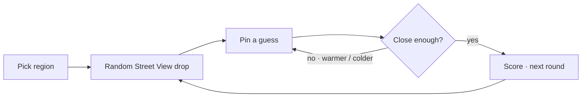

<div align="center">



<p>
  <a href="https://peek-and-seek.vercel.app"></a>
  
  
  
</p>

<p><em>Dropped somewhere in the world through Street View, you pin your guess on the map.<br>
Warmer or colder after every pin; fewer guesses, far more points.</em></p>


</div>


## How to play

Each game has **5 rounds** and each round gives you **10 guesses**. After every pin you hear whether you are getting warmer or colder. Scoring is exponential, so finding a place in two guesses is worth far more than in eight. All of it sits on a bone-white page with an animated, sketch-style world map behind it.

| | |
|---|---|
| **Street View drops** | A random street-level location every round. |
| **Pin and guess** | Click the world map to drop a pin, up to ten times. |
| **Warmer / colder** | A hint after every guess. |
| **5-round scoring** | Precision rewarded exponentially. |
| **Regions** | Play the World, Europe, Turkey, the Americas or Asia. |




## Türkçe özet

**Peek & Seek**, Google Street View ile dünyanın rastgele bir yerine bırakıldığın ve haritaya pin atarak konumu bulmaya çalıştığın bir coğrafya tahmin oyunu. Her turda 10 hakkın var; her pinden sonra yaklaşıp yaklaşmadığını söyleyen sıcak-soğuk ipucu geliyor. 5 turda ne kadar az hamleyle bulursan o kadar çok puan alıyorsun. Dünya, Avrupa, Türkiye, Amerika veya Asya seçilebiliyor.


## Development

```sh
npm install
cp .env.example .env.local   # Google Maps key
npm run dev                  # Express + Vite
npm run build
```

<div align="center">
<br>
<a href="https://github.com/kutluhangil"></a>
<sub>Look closer. Guess smarter.</sub>
</div>
