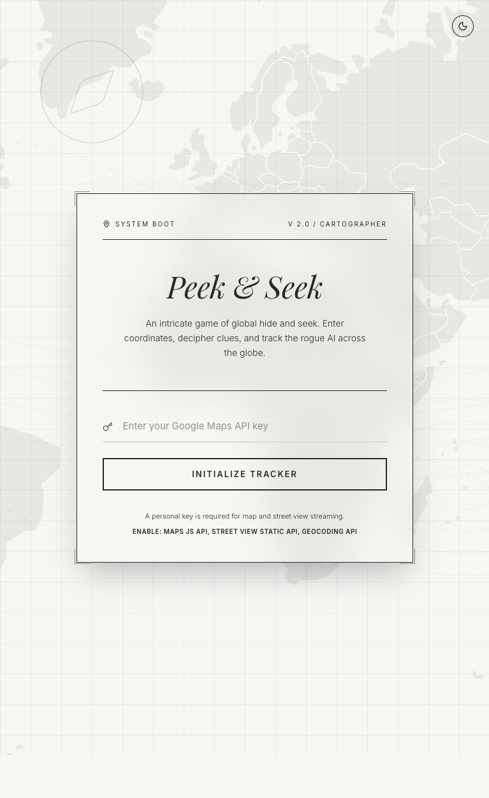
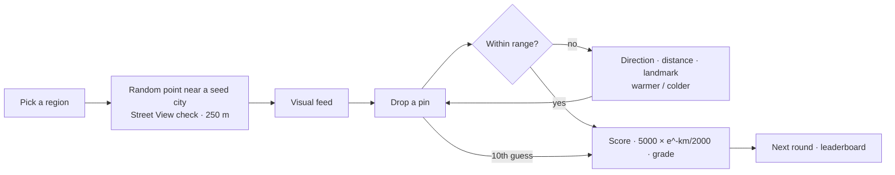

<div align="center">


<p>
  <a href="https://peek-and-seek.vercel.app"></a>
  
  
  
</p>

<p><em>Can you find it on the map? A street-level photo, a sketched world map and ten guesses:<br>
every pin tells you which way to go and how far, until you land on it.</em></p>



</div>


## How to play

Each game has **5 rounds**, and each round gives you **10 guesses**. Study the visual feed, pan the map and drop a pin. The game answers like a radio operator: *head east towards Ankara, about 420 km*, *getting warmer*, *moving away, reverse course*, until you are close enough and the target is found. Stuck? Trade a guess for the country's name.

> **Distance decides the score, not luck.** A round is worth up to 5,000 points, falling off smoothly with how far your final pin is from the target: `5000 × e^(−km / 2000)`. Within 50 m you get the full 5,000; at 15,000 km or more, nothing.


## Features

| | |
|---|---|
| **Street View drops** | A random location per round, checked against Street View coverage within 250 m before it is used. |
| **Ten guesses** | Pin, remove, re-pin; the round ends when you are on target or out of guesses. |
| **Directional hints** | After each pin: the compass direction, the distance, and the nearest landmark when there is one. |
| **Warmer / colder** | Messages for big progress, getting warmer, circling, moving away and wrong direction. |
| **Country hint** | Reverse-geocode the target's country for the price of one guess. |
| **Regions** | World, Europe, Turkey, the Americas and Asia. |
| **Scores and grades** | Up to 5,000 per round, 25,000 per game, graded S, A, B, C or D. |
| **Leaderboard** | Your top ten games, kept in the browser. |
| **Look and sound** | A bone-white page with an animated sketch-style world map, small sound cues, TR / EN. |


## How a round works



| Grade | Round score |
|---|---|
| S | 4,800+ |
| A | 4,000+ |
| B | 2,500+ |
| C | 1,000+ |
| D | below 1,000 |


## Türkçe özet

**Peek & Seek**, Google Street View üzerinde oynanan bir konum tahmin oyunu. Her oyunda 5 tur, her turda 10 tahmin hakkı var. Sokak görüntüsüne bakıp haritaya iğne bırakıyorsun; oyun her tahminden sonra yönü, mesafeyi ve varsa en yakın simge yapıyı söylüyor ("doğuya, Ankara'ya doğru ~420 km", "ısınıyorsun"). Bir hamle karşılığında ülke ipucu alınabiliyor. Puan son iğnenin uzaklığına göre en fazla 5.000; S'den D'ye not, tarayıcıda ilk 10 skor tablosu, dünya, Avrupa, Türkiye, Amerika ve Asya bölgeleri var.


## Development

```sh
npm install
cp .env.example .env.local   # VITE_GOOGLE_MAPS_API_KEY (+ GOOGLE_MAPS_API_KEY for the server)
npm run dev                  # Express + Vite
npm run build
npm run lint
```

The browser uses `VITE_GOOGLE_MAPS_API_KEY` for the Maps JavaScript API (restrict it by referrer); `api/streetview.ts` serves static Street View images with the server-side `GOOGLE_MAPS_API_KEY`.

```
src/components/   LandingPage, MapSection (the game), WorldMap (sketch map), Footer
src/lib/          scoring, regions, leaderboard, sounds, storage
api/              streetview and health (Vercel functions)
server.ts         local server
```

<div align="center">
<br>
<a href="https://github.com/kutluhangil"></a>
<sub>MIT licensed · imagery © Google · the street and location in the banner are drawn.</sub>
</div>
